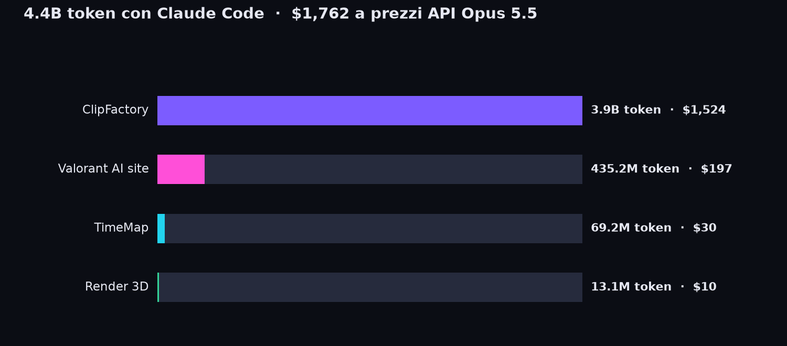

# Ciao 👋

Sto costruendo **ClipFactory**, un servizio che trasforma video lunghi in clip verticali pronte per TikTok e Shorts, scritto quasi interamente con Claude Code.

## ⚡ Token con Claude Code

| Progetto | Token | Output | Scrittura cache | Lettura cache | Costo API |
|---|---:|---:|---:|---:|---:|
| ClipFactory | 3.9B | 20.1M | 67.7M | 3.8B | $1,524 |
| Valorant AI site | 435.2M | 3M | 9.9M | 421.4M | $197 |
| TimeMap | 69.2M | 412.5K | 1.7M | 67.1M | $30 |
| Render 3D | 13.1M | 254.9K | 424.7K | 12.4M | $10 |
| **Totale** | **4.4B** | **23.8M** | **79.7M** | **4.3B** | **$1,762** |

Token dalla pagina Utilizzo di ogni progetto Claude Code (letti il 24/10/2026 03:20). Costo calcolato con i prezzi API di Claude Opus 5.5 per milione di token: input $4, output $20, scrittura cache $5, lettura cache $0.2. È quanto costerebbero gli stessi token pagando le API, non quanto pago con l'abbonamento Max.

## 🏭 ClipFactory in numeri

**37** commit · **+57.323** righe · **−3.860** righe in 3 giorni

---
Aggiornato automaticamente il 24/10/2026 03:15 (ora italiana).
