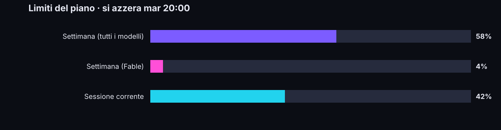

# Ciao 👋

Sto costruendo **ClipFactory**, un servizio che trasforma video lunghi in clip verticali pronte per TikTok e Shorts, scritto quasi interamente con Claude Code.

## 🔋 Piano Claude Max (20x)

Settimana: **58%** usato (si azzera mar 20:00) · Fable: **4%** · Sessione: **42%** · Letture: 1

Percentuali lette dalla pagina Utilizzo delle impostazioni di Claude.

## ⚡ Token con Claude Code

_In attesa del primo conteggio: il grafico compare appena la sessione di Claude Code carica i dati di ccusage._

## 🏭 ClipFactory in numeri

**37** commit · **+57.323** righe · **−3.860** righe in 3 giorni

---
Aggiornato automaticamente il 24/10/2026 03:08 (ora italiana).
